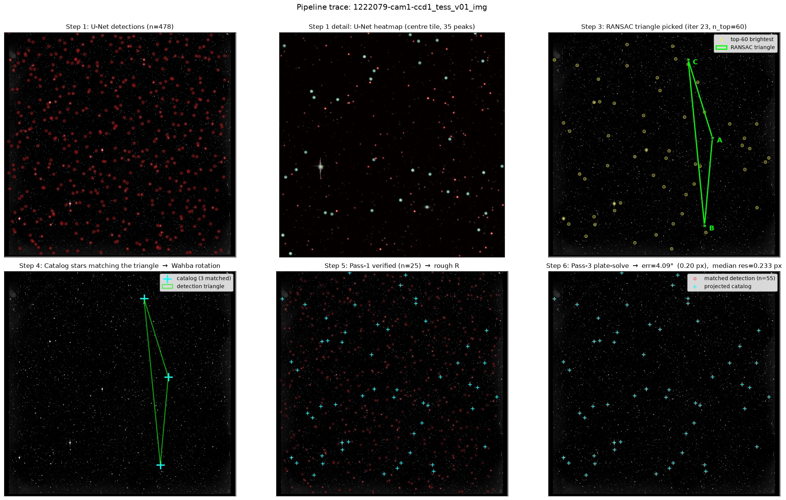
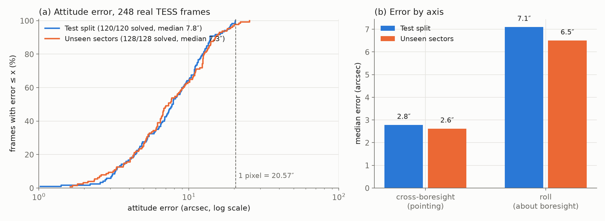

# Star Tracker: lost-in-space spacecraft attitude from real NASA TESS images

[](https://github.com/SpaceDevEngineer/star-tracker/actions/workflows/ci.yml)


[](LICENSE)
[](https://star-tracker-6vwnvtkvpow2eysg23i45l.streamlit.app)

**Given one photo of the sky and nothing else, which way is the spacecraft pointing?**
This project answers that on **real images taken in orbit by NASA's TESS satellite**,
with no initial guess, no gyroscope and no star labels. A U-Net finds the stars and
measures their positions to a fraction of a pixel. Classical geometry (triangle
matching, RANSAC, Wahba's problem, plate solving) then works out the full 3-axis attitude.
Every answer is checked, so the system either returns the right answer or refuses.

### 🎯 [Try the live interactive demo →](https://star-tracker-6vwnvtkvpow2eysg23i45l.streamlit.app)

*Walks through every pipeline stage with the real numbers (detections, triangle,
plate solve, quality gate, final attitude) on 16 TESS images. Replay mode renders in
about 5 seconds; Live mode runs the full search.*



---

## Results

End-to-end lost-in-space attitude on **248 real TESS frames**: the held-out test
split, plus 8 TESS sectors that played no part in training or model selection.

| | Test split | Unseen sectors |
|---|---:|---:|
| Frames solved | **120 / 120** | **128 / 128** |
| Wrong answers (false locks) | **0** | **0** |
| Median attitude error | **7.79″** (0.38 px) | **7.33″** (0.36 px) |
| 90th percentile | 13.87″ | 15.02″ |
| Worst frame | 20.39″ | 25.35″ |
| Errors below one pixel (20.57″) | 120 / 120 | 125 / 128 |
| Median pointing / roll error | 2.78″ / 7.10″ | 2.61″ / 6.50″ |
| Solved at first attempt / after a retry | 117 / 3 | 124 / 4 |

- **Sub-pixel accuracy.** The typical error is about a third of a pixel. One pixel
  covers 20.57 arcseconds of sky.
- **Generalises.** The unseen sectors (different years and different parts of the sky)
  give the same accuracy as the test split. 95% confidence interval for the solve
  rate: 96.9–100% (test) and 97.1–100% (unseen sectors).
- **Fast enough to iterate on.** Typical frame time is **9.4 s** (median over all 248
  frames, U-Net on GPU). That is 27× faster than the first version, with identical
  results on every frame.
- **Never confidently wrong.** In 248 frames, no wrong attitude was ever returned.



Per-frame results for all 248 frames are in
[`Results/full_test_per_frame.csv`](Results/full_test_per_frame.csv) and
[`Results/unseen_sectors_per_frame.csv`](Results/unseen_sectors_per_frame.csv). The summary
metrics are in [`full_test_metrics.json`](Results/full_test_metrics.json) and
[`unseen_sectors_metrics.json`](Results/unseen_sectors_metrics.json). More tables are in
[RESULTS.md](RESULTS.md).

---

## How it works

```
   TESS image (2136 × 2078 px) + camera calibration (SIP distortion, CRPIX, CD scale/shear)
        │
   1  U-Net detection        16 tiles of 512×512 → heatmap → ~450 sub-pixel star centroids
        │
   2  Body vectors           remove lens distortion (SIP) → unit direction for every star
        │
   3  Star identification    RANSAC over triangles of bright stars, matched against a
        │                    Hipparcos pair-angle database (25k stars, V < 7.5)
   4  Attitude               Wahba's problem (SVD) on every verified star
        │
   5  Plate solve            least-squares refinement of (RA, Dec, roll) in pixel space
        │
   6  Quality gate           refuse if the post-fit residual is > 2 px
        │
   7  Refusal-retry          re-search with the refused sky region excluded and
        │                    significance-aware stopping (only if step 6 refused)
        ▼
   attitude quaternion
```

The neural network only does step 1. Everything after it is geometry that can be
checked, which is why a wrong identification cannot slip through quietly.

---

## Engineering highlights

**1. Learned detection improves accuracy through centroid precision.** With everything
else held fixed and true star matches supplied, swapping the classical peak finder for
the U-Net improves the attitude error from 6.0″ to **4.6″ (23% better)**. The gain comes
from more precise star positions, not from finding more stars.


**2. Found and fixed a failure mode that only appears on real data.** At first, 7 of
the 248 frames were refused. In every case the search had locked onto a false pattern
in Carina, the densest part of the Milky Way, where random stars line up by chance.
The quality gate caught all 7 (residuals of 9–12 px against 0.1–0.2 px for correct
answers), so no wrong attitude was returned. Diagnosis showed that the true answer would
have scored *more* matches. The search had stopped too early because it counted raw
matches. The fix compares each candidate with the number of matches expected by chance
in that part of the sky: every correct lock is at least 7.4× above chance, and every
false one is at most 3.6×. With a 5× threshold, **all 7 frames are recovered** at the
first retry with normal accuracy (0.13–0.17 px residual).


**3. Lens distortion matters at the edge of a 12° field.** A plain pinhole model hid
200–1000″ residuals at the field corners, because TESS needs a 6th-order SIP distortion
polynomial. With known star matches the error looked fine (4.6″), but the blind
pipeline failed on every image. Applying the SIP correction before projection fixed it.

**4. 27× faster star identification, identical results.** Profiling showed that almost
all the time went into searching the catalogue for the third star of each triangle, not
into the neural network. Restricting that search to precomputed neighbour lists cut the
median frame time from 211 s to **9.4 s**. All 248 frames return the same attitude, the
same number of iterations and the same number of attempts as before.


**5. Tested the textbook extra check and reported what it actually did.** The classic
Pyramid 4th-star check changed nothing on clean frames (117–118 / 120 in every
variant), and the textbook version would have vetoed 69% of true triangles. It only
helps when many false stars are injected (+12 frames at +0.5× contamination), and
it never prevents a false lock that the residual gate would not already catch.

---

## Detector comparison

Centroid quality with known star matches (`--use-gt` protocol, 120 test images):

| Detector | Parameters | Median attitude error |
|---|---:|---:|
| Classical peak finding | n/a | 6.0″ |
| **U-Net** (used in the pipeline) | 7.76 M | **4.6″** |
| HRNet | 3.99 M | 4.8″ |

HRNet comes within 0.2″ of the U-Net with half the parameters, which suggests that
detector architecture is not the main accuracy bottleneck.

---

## Try it

Requires Python ≥ 3.10.

```bash
git clone https://github.com/SpaceDevEngineer/star-tracker.git
cd star-tracker
python3 -m venv .venv
source .venv/bin/activate          # Windows: .venv\Scripts\activate
python3 -m pip install -r requirements.txt
```

> **First run.** The first call builds and caches the Hipparcos pair-angle database
> and the neighbour lists (about 1–2 minutes). After that a frame typically takes
> seconds on a laptop CPU. Replay mode in the demo skips the search entirely.

### Interactive Streamlit walkthrough

```bash
streamlit run Code/Streamlit_app/pipeline_app.py
```

Opens at <http://localhost:8501>. Pick one of the 16 bundled TESS images and press
*Run pipeline*. Every stage shows its real intermediate values: body vectors, the
triangle-angle table, plate-solve iterations, and the final attitude compared with
the reference.

### End-to-end batch run

```bash
python3 Code/Star_ID/inference_full.py \
    --data-dir Data/dataset_tess_test \
    --model    Results/unet_run3/best_model.pt \
    --catalog  Data/hybrid/catalog_hipparcos_full.csv \
    --out-dir  Results/star_id_run
```

This writes one JSON file per image and prints the solve rate and error statistics.
On the bundled 16-frame demo set it solves **16 / 16**, median **6.93″**, with
0 false locks. `--retries 0` turns off the refusal-retry.

### Visualisations

```bash
python3 Code/Star_ID/visualize_inference.py \
    --data-dir Data/dataset_tess_test \
    --run-dir  Results/star_id_run \
    --out-dir  Results/star_id_run/viz
```

### Tests

```bash
python3 -m pytest -q
```

The tests cover the attitude geometry (including a check that every pose parameter
moves the sky exactly as the scored rotation says), the published result tables, and
the Streamlit replay. They run on every push in GitHub Actions.

---

## Repository layout

```
star-tracker/
├── README.md                ← this file
├── RESULTS.md               ← detailed result tables
├── PROJECT_DESCRIPTION.md   ← longer technical write-up
├── Code/
│   ├── Star_ID/
│   │   ├── inference_full.py       ← full lost-in-space pipeline + refusal-retry
│   │   ├── triangle_id.py          ← RANSAC star identification (neighbour-list search)
│   │   ├── summarize_results.py    ← per-frame tables + metrics from run artefacts
│   │   ├── make_results_figure.py  ← docs/images/results.png from the tables
│   │   ├── visualize_inference.py  ← per-image diagnostic plots
│   │   └── visualize_pipeline.py   ← 6-panel pipeline trace
│   ├── Model_train_code/train.py   ← U-Net architecture + training
│   ├── HRNet_train/                ← HRNet architecture + training + inference
│   ├── Tess_Dataset/process_tess.py ← FITS → PNG + JSON labels (with SIP WCS)
│   └── Streamlit_app/pipeline_app.py
├── Data/
│   ├── dataset_tess_test/  ← 16 TESS demo images + labels
│   └── hybrid/             ← Hipparcos catalogue
├── Results/
│   ├── full_test_per_frame.csv / full_test_metrics.json          ← 120 test frames
│   ├── unseen_sectors_per_frame.csv / unseen_sectors_metrics.json ← 128 unseen-sector frames
│   ├── star_id_run/                ← demo-set artefacts used by Replay mode
│   └── unet_run3/best_model.pt     ← trained U-Net weights (30 MB)
└── tests/
```

The full 800-image dataset, the FITS archives and the HRNet weights stay with the
research project. This repository carries what is needed to run the demo, read the
code and audit the published numbers.

---

## Tech stack

**ML:** PyTorch (U-Net and HRNet heatmap regression, weighted-MSE loss, sub-pixel
centroiding). **Geometry:** NumPy, SciPy (SVD, nonlinear least squares), quaternions,
gnomonic projection. **Astronomy:** Astropy (FITS, WCS, SIP distortion), Hipparcos
catalogue. **Algorithms:** RANSAC, Wahba's problem, triangle matching with chirality
check, significance-aware stopping. **Tooling:** Streamlit, Matplotlib, pytest, GitHub
Actions, SLURM GPU cluster.

---

## Limitations

- **Reference attitude.** The reference comes from the WCS solution of the same TESS
  image, which is very accurate but not fully independent. The pipeline reads only the
  camera calibration from it (SIP, CRPIX and the attitude-free part of CD).
- **One camera.** TESS is a survey telescope, not a flight star tracker: 12° field,
  long exposures, 21″ pixels. Results on a real star-tracker camera are future work.
- **The retry rule was designed after seeing the failures.** The 5× significance
  threshold sits in the gap between all 241 correct locks (≥ 7.4×) and all 7 false
  ones (≤ 3.6×). It runs only after the gate refuses, so it cannot change any frame
  solved at the first attempt.
- **Roll is the weak axis.** A single 12° frame pins the pointing to about 3″, but
  rotation about the boresight to only about 7″.
- **Runtime.** 9.4 s per frame on a desktop GPU + CPU is fine for research but slow
  for a flight tracker (which runs at several Hz on embedded hardware).

---

## Acknowledgements

NASA's TESS mission and the TICA team for the public full-frame images. ESA's Hipparcos
mission for the reference star catalogue.

## Author

**Temur Kuchkorov**, Master's thesis project, 2025–2026.
[Email](mailto:timka02qochqorov@gmail.com) · [LinkedIn](https://www.linkedin.com/in/temurkuchkorov/)

## License

MIT, see [LICENSE](LICENSE).
