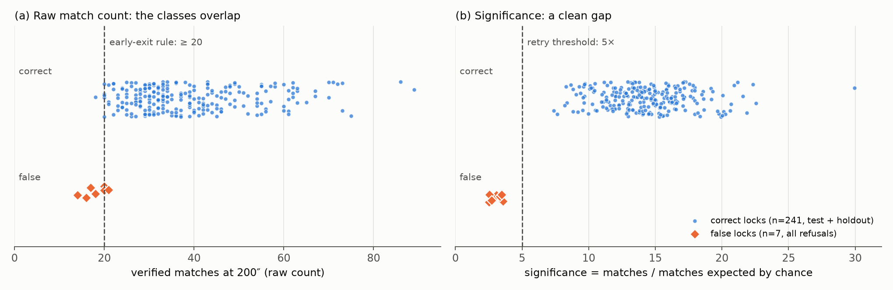
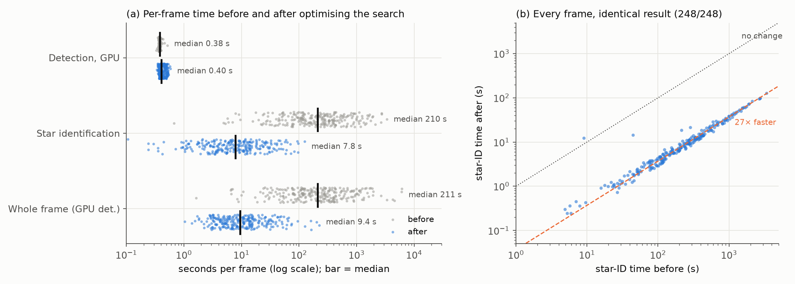
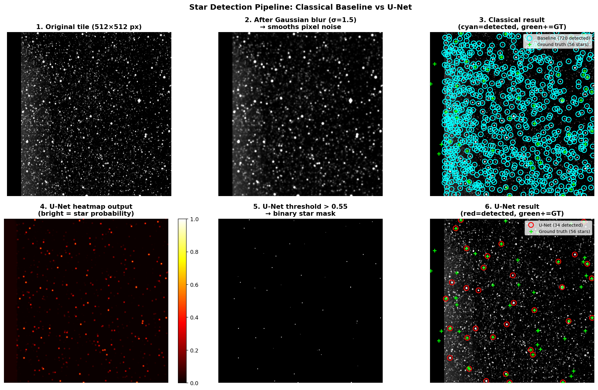
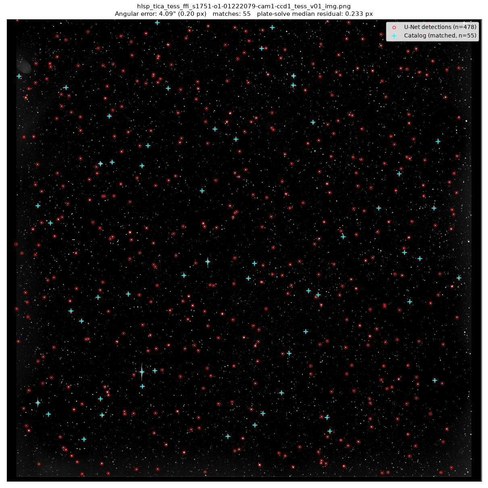

# Detailed Results

End-to-end lost-in-space attitude determination on real NASA TESS images: no initial
pose, no IMU prior, no supplied star correspondences. The attitude error is the angle
of R_gtᵀ R_pred between the returned body-to-ICRS rotation and the reference from the
image's own WCS solution. The cross-boresight (pointing) and roll parts are the (y, z)
and x components of that rotation's rotation vector. One pixel is 20.57″.

## 1. Final pipeline: 248 frames

The held-out **test split** has 120 frames (70/15/15 split by image, seed 42). The
**unseen sectors** are 128 frames from 8 TESS sectors (16 frames each) that were never
used for training or model selection.

| Metric | Test split | Unseen sectors |
|---|---:|---:|
| Frames solved | **120 / 120** | **128 / 128** |
| Solve rate, 95% Wilson interval | 96.9–100% | 97.1–100% |
| Refusals | 0 | 0 |
| False locks (wrong identification) | **0** | **0** |
| Median attitude error | **7.79″ (0.379 px)** | **7.33″ (0.357 px)** |
| Mean | 8.55″ | 8.69″ |
| 90th / 95th percentile | 13.87″ / 18.00″ | 15.02″ / 18.04″ |
| Best / worst frame | 1.02″ / 20.39″ | 1.62″ / 25.35″ |
| Below one pixel (20.57″) | 120 / 120 | 125 / 128 |
| Below one arcminute | 120 / 120 | 128 / 128 |
| Cross-boresight median / p90 | 2.78″ / 5.04″ | 2.61″ / 4.78″ |
| Roll median / p90 | 7.10″ / 13.70″ | 6.50″ / 14.71″ |
| Solved at first attempt | 117 | 124 |
| Recovered by the refusal-retry | 3 | 4 |
| Frame time, median (GPU detection) | 8.6 s | 10.6 s |

With 0 false locks in 248 frames, the 95% upper bound on the false-lock rate is below 1.5%.
Per-sector medians on the unseen sectors range from 6.0″ to 9.6″, and every sector
solves 16 of 16.

Data: [`full_test_per_frame.csv`](Results/full_test_per_frame.csv),
[`unseen_sectors_per_frame.csv`](Results/unseen_sectors_per_frame.csv) (one row per
frame with status, total / pointing / roll error, attempts, matches, RANSAC iterations,
residual and frame time), plus the matching `*_metrics.json`. They were generated from
the evaluation-run artefacts with
[`summarize_results.py`](Code/Star_ID/summarize_results.py).

## 2. First attempt vs final pipeline

The refusal-retry runs only after the quality gate refuses an answer, so frames solved
at the first attempt are identical in both columns.

| | First attempt | Final (with retry) |
|---|---:|---:|
| Test split solved | 117 / 120 (97.5%) | **120 / 120** |
| Test median error | 7.72″ | 7.79″ |
| Unseen sectors solved | 124 / 128 (96.9%) | **128 / 128** |
| Unseen median error | 7.33″ | 7.33″ |
| False locks | 0 | 0 |

## 3. The seven refusals and how the retry fixed them

At the first attempt, the triangle search on 7 of 248 frames locked onto a false
pattern in Carina, the densest bright-star region of the southern Milky Way (190–200
catalogue stars per half field, against a sky median of 64). The true fields of these
frames were star-poor, so a correct triangle came up in only 3–15% of draws. Meanwhile
the dense false region gathered 16–21 chance matches quickly, and the raw-count
stopping rule ended the search early.

The post-fit quality gate refused all seven, because the residuals were 9–12 px
instead of the usual 0.1–0.2 px. So no wrong attitude was returned. The retry excludes
the refused sky region (6° radius) and only stops early on a candidate that is at least
5× above the number of matches expected by chance in its own sky region.

| Frame | Refused lock (off by) | Gate residual | Retry: error | Retry: residual | Iterations | Significance |
|---|---:|---:|---:|---:|---:|---:|
| s0029 cam2 ccd2 | 116° | 11.9 px | 5.12″ | 0.12 px | 92 | 10.8× |
| s0029 cam3 ccd1 | 150° | 10.2 px | 6.60″ | 0.15 px | 204 | 14.7× |
| s0045 cam4 ccd1 *(test)* | 77° | 10.7 px | 9.68″ | 0.15 px | 40 | 9.0× |
| s0084 cam1 ccd3 *(test)* | 160° | 11.0 px | 3.74″ | 0.17 px | 57 | 14.5× |
| s0092 cam2 ccd2 | 165° | 11.5 px | 15.04″ | 0.14 px | 173 | 17.8× |
| s0092 cam2 ccd4 | 118° | 10.2 px | 7.68″ | 0.14 px | 219 | 14.0× |
| s0093 cam4 ccd1 *(test)* | 113° | 9.3 px | 7.86″ | 0.13 px | 203 | 8.1× |

All 241 correct first-attempt locks are ≥ 7.4× above chance (median 14×), and all 7
false locks are ≤ 3.6×. The 5× threshold sits in the empty gap between them. Every
frame was recovered on the first retry.



## 4. Runtime: 248 frames, before and after the search optimisation

One node, 4 processes × 4 threads, Xeon Silver 4216 + RTX 2080 Ti. The optimisation
restricts the third-star search to precomputed catalogue neighbour lists. Both runs
return the same attitude, iterations and attempts on all 248 frames.

| Stage, per frame | Before: median / mean / max | After: median / mean / max |
|---|---:|---:|
| Detection (U-Net, GPU) | 0.38 / 0.38 / 0.52 s | 0.40 / 0.43 / 0.59 s |
| Star identification (CPU) | 210 / 388 / 3389 s | **7.8 / 14.2 / 126 s** |
| Refinement + quality gate | 0.98 / 0.92 / 2.0 s | 1.1 / 1.2 / 2.7 s |
| **Whole frame** | 211 / 446 / 6161 s | **9.4 / 17.9 / 226 s** |
| Refusal-retry, extra (6 frames) | 2591 / 2364 / 3415 s | 91 / 82 / 127 s |

The median per-frame speed-up of star identification is 27× (21–32× between the 10th
and 90th percentile). The whole 248-frame evaluation dropped from 30.8 h to 1.2 h. On a
CPU with four threads, the U-Net takes about 13 s per frame.



## 5. Detector benchmark: known correspondences

The `--use-gt` protocol supplies the true star matches, so only the detector's centroid
noise affects the attitude. This isolates the deep-learning component from star
identification.

| Detector | Parameters | Solve rate | Median | 90th pct | Max |
|---|---:|---:|---:|---:|---:|
| Classical peak finding | n/a | 100% | 6.0″ | 11.4″ | n/a |
| **U-Net** (run 3) | 7,762,465 | 100% | **4.6″** | **9.5″** | 13.5″ |
| HRNet | 3,987,393 | 100% | 4.8″ | 9.7″ | 13.3″ |

The U-Net is 23% more accurate than classical peak finding, because its centroids are
more precise, not because it finds more stars. The classical detector returns
thousands of peaks per image, many of them real stars too faint for the catalogue,
so its detection F1 of 0.10 (vs 0.636 for the U-Net) understates it. End-to-end
attitude error is the fair comparison.



## 6. Pyramid 4th-star check: ablation

The classic Mortari "Pyramid" check verifies a 4th star before accepting a triangle.
It was implemented in two variants and run on identical frames and seeds (first attempt,
test split):

| Arm | Solved | Median | p90 | False locks |
|---|---:|---:|---:|---:|
| No check | 117 / 120 | 7.72″ | 13.88″ | 0 |
| Hard check (textbook) | 118 / 120 | 7.79″ | 13.88″ | 0 |
| Soft check (veto only on contradiction) | 117 / 120 | 7.72″ | 13.88″ | 0 |

Under injected false-star contamination (same seeds across arms):

| Contamination | No check | Hard check | Soft check | False locks (off / hard / soft) |
|---|---:|---:|---:|---:|
| +0.5× | 70 | **84** | 78 | 0 / 0 / 0 |
| +1× | 20 | 27 | 21 | 3 / 3 / 2 |
| +2× | 9 | 12 | 10 | 9 / 11 / 10 |

On clean data the check is inert. The textbook version would have vetoed 575 of 836
almost-certainly-true triangles, mostly because the 4th star is too faint for the
catalogue. It helps under heavy contamination by saving search budget, but it never
prevents a false lock that the post-fit residual gate would not already catch. It is
off in the final pipeline.

## 7. Bundled demo set: 16 TESS images

The repository includes one complete TESS exposure (all 16 CCDs) so that the Streamlit
Replay mode and the batch command work from a normal clone. The results below come from
running the code in this repository on a laptop CPU.

| Metric | Result |
|---|---:|
| Frames solved | **16 / 16** (no retry needed) |
| False locks | 0 |
| Median attitude error | **6.93″ (0.34 px)** |
| 90th percentile / worst | 17.57″ / 27.01″ |
| Best frame | 2.27″ (0.11 px) |
| Below one pixel | 14 / 16 |
| Median pointing / roll error | 3.11″ / 4.39″ |

```
cam1/ccd1   4.09″       cam2/ccd1   27.01″      cam3/ccd1   14.33″      cam4/ccd1    4.78″
cam1/ccd2  20.82″       cam2/ccd2    7.14″      cam3/ccd2    8.46″      cam4/ccd2    7.02″
cam1/ccd3   5.73″       cam2/ccd3    6.83″      cam3/ccd3    2.84″      cam4/ccd3    4.61″
cam1/ccd4   8.06″       cam2/ccd4    2.27″      cam3/ccd4    2.51″      cam4/ccd4   11.11″
```


*Red = U-Net detections, cyan = catalogue projected through the final attitude, green
lines = matched pairs.*

## 8. Models

| Model | Architecture | Params | Notes |
|---|---|---:|---|
| **U-Net** | 4-level encoder-decoder, skip connections | 7,762,465 | Run 3, best F1 = 0.636 at threshold 0.55 |
| HRNet | Multi-resolution parallel branches | 3,987,393 | Same targets and training setup |

Training setup (shared by both models):

- 50 epochs, Adam (lr 1e-3) with cosine annealing
- Heatmap target: Gaussian σ = 1.5 px, peak normalised to 1.0
- Weighted MSE loss: star pixels × 20, background × 1
- Split 70 / 15 / 15 by image (560 / 120 / 120), seed 42, so no tile-level leakage
- 8,960 training tiles of 512×512; augmentation with flips and 90° rotations
- Best checkpoint selected by validation F1, not by loss (loss is a poor proxy on
  sparse targets)
